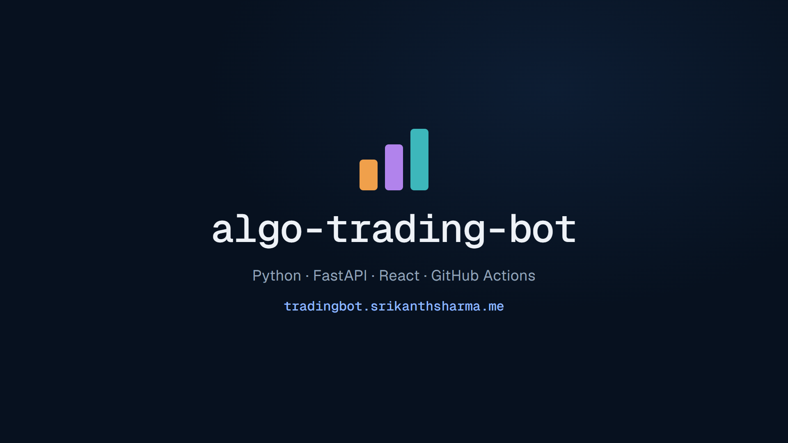

# 🚀 Algo Trading Bot: ETF Rotation Backtester & Paper Trading for Discord & Telegram

   

---

algo-trading-bot is a rules-based ETF rotation strategy built in Python, complete with a realistic backtester that fills orders at the next open and charges trading costs on every dollar moved. Rather than trusting a single in-sample result, it evaluates performance out of sample and stress-tests nearby settings, costs, and parameter choices so you can see where the edge holds up and where it doesn't. The same strategy code that runs the backtest also powers paper trading through Alpaca, giving you a full pipeline from research to live simulation. It's built for anyone who wants to dig into the mechanics, swap in their own ideas, and learn together as the project grows.

## Features

- **Rules-based ETF rotation, fully in Python.** Every trading day the bot checks bond-market signals in order and picks one of a few portfolios — risk-on equity funds, a rising-rates mix, or a defensive falling-rates basket — then holds until the signals flip. The whole decision fits in one pure function, so you can read exactly why it bought what it bought.

- **A backtester that tells the truth.** Decisions use prices through the close and fill at the next open, so there's no look-ahead. Trading costs are charged on every dollar bought or sold, portfolio weights drift with prices, and rebalancing only fires when drift actually matters. It's built to make a strategy look worse, not better.

- **Out-of-sample evaluation baked in.** A holdout window is fixed before any backtest runs, and the reported metrics — CAGR, volatility, Sharpe, max drawdown — always show in-sample and out-of-sample side by side. Parameter sweeps and cost-sensitivity curves are included, so you can see whether an edge survives nearby settings or just one lucky number.

- **Paper trading via Alpaca.** A scheduled daily job on a paper account compares the target portfolio against what you actually hold and sends whole-share orders for the difference. Safe retries, dry-run planning, and a step-by-step trace of every run mean you can watch it think before it trades.

- **Reproducible by design.** Indicators are computed over a fixed history window so live and backtest decisions on the same day match exactly. Market data flows through a swappable port with an on-disk cache, so backtests run offline and you can plug in your own data source.

- **Community-friendly and hackable.** Small, focused modules — universe, indicators, strategy, backtest, broker, reconciliation — each with its own tests. Want to add a new ETF, tweak a rule, or swap in a different broker? You'll find the seam quickly.

- **Transparent results.** Every run, decision and backtest is written out as structured records you can inspect, diff, or build on. Nothing is hidden behind a black box — the reasoning behind each pick travels with the pick.

- **Built to be trusted, not hyped.** Paper trading only, no investment advice, and the docs say so plainly. The point is a realistic, testable research tool for the community — bring your ideas, stress them, and see what holds up.

## Commands

Every workflow lives behind a small set of friendly CLI commands. Run any command with the project name to see the available options and defaults, and pass a flag like `--cost-bps` to tweak how it behaves.

**Backtest**
- `backtest` — replays the ETF rotation rules day by day with next-open fills, realistic trading costs and weight drift, then reports CAGR, volatility, Sharpe and max drawdown. The first run downloads prices, and later runs reuse the local cache.
- `backtest --cost-bps <n>` — re-prices the same trades at a higher or lower cost per dollar traded, handy when stressing the strategy's sensitivity to costs.

**Sweep**
- `sweep` — runs the parameter grid around the published settings and the trading-cost curve, and writes results to the backtest data directory so the console can show the surface and the cost table.

**Live paper trading**
- `live` — decides on the latest completed day, reconciles the target weights against the broker's holdings, and sends whole-share orders for the difference. Client order IDs make retries safe.
- `live --dry-run` — prints the planned orders for today without touching the broker, so you can sanity-check a decision first.

**Export and console**
- `export --out <dir>` — writes every API route as a static JSON file at the matching path, so the console can run without a server.
- `openapi` — prints the typed API contract that the console's TypeScript client is generated from.

**Backtest data**
Backtest and sweep outputs land in `data/backtest/`, and each live run is stored as a JSON record under `data/live/`, keeping runs reproducible and easy to inspect.

## Setup

# Setup

Getting up and running is quick, and you don't need an account anywhere just to explore the backtester. Everything runs locally against cached data after the first fetch.

## What you'll need

- **Python 3.12** — the package targets it and the locks are pinned to it.
- **uv** — the whole workflow (sync, run, test, lint) goes through it. You don't need to activate any virtualenv by hand.
- **Optional: Alpaca paper-trading keys** — only if you want to plan or place live paper orders. Backtests, sweeps and the console work without them.

## First run

Sync dependencies once, then poke at the strategy:

- `uv run algo-trading backtest` — runs the full daily simulation. The first invocation downloads prices through the Yahoo Finance adapter and writes a Parquet cache, so later runs are offline and fast.
- `uv run algo-trading sweep` — parameter grid and trading-cost sensitivity, written to `data/backtest/` as JSON for the console.
- `uv run pytest -m "not network"` — the fast test suite. Drop the marker to also exercise the network-backed data path.
- `uv run ruff check && uv run mypy` — lint and strict typing, the same checks CI runs.

## Explore decisions, not just numbers

The strategy is a pure function: `strategy(closes, params) -> Decision`, returning target weights *plus* the rule that fired, each rule's inputs, and the RSI ranking. That means every backtest decision is inspectable — no black box. Backtests fill at the **next day's open** with costs charged on every dollar traded, so what you see is what a real runner would have faced.

## Go live (paper only)

1. Create an Alpaca **paper** account and note the key and secret. These are never committed.
2. Do a dry plan before anything else:
 - `uv run algo-trading live --dry-run` decides on the latest completed day, compares target weights with current holdings, and prints the whole-share orders it *would* send. Nothing leaves your machine in dry-run.
3. When the plan looks right, run without `--dry-run`. Each run records its steps, timings, orders and API calls as JSON under `data/live/` so you can replay exactly what happened. Client order IDs make retries safe if a call is interrupted.

The scheduled job runs every weekday at 09:35 New York time, checks the broker's clock, and reconciles the target against the account before sending orders. Paper trading only — nothing here is investment advice.

## The console, locally

The web console reads a static JSON API. To build that data locally and start it:

- `uv run algo-trading export --out web/public` writes every API route as a JSON file at the same path.
- In `web/`, install the frontend dependencies and start the dev server — it serves on the usual Vite port and reads from the exported files, no backend required.

Because the export is just files, you can diff two exports to see how a parameter change moved the decisions before you commit to it.

## Configuration

Defaults live in code and the CLI flags; the main knobs are:

- **Bond lookback** (60 days) and **risk-on RSI window** (10 days) — the two windows the rules read.
- **Cost per dollar traded** — `--cost-bps` on the backtest, which re-prices existing trades rather than re-running.
- **Rebalance threshold** — the summed drift (2 percentage points) that triggers a rebalance.
- **Fixed 250-day RSI history** so live and backtest decisions on the same day match exactly.

Tune any of these, re-export, and the console updates — no rebuild of the console needed.

## A note on staying honest

The 2023-onward window is a fixed out-of-sample split. Before you trust a change, re-run `sweep` and look at whether the result holds on the held-out years and survives higher costs; the near-neighbor grid makes "this setting is secretly luck" easy to spot. That's the whole point of shipping the seams alongside the results.

## Configuration

Everything the bot needs lives in a single config file, so you can tune the strategy, the backtester and the live runner without touching code. Copy the example config that ships with the project, open it in your editor, and you are ready to go — no environment variables to juggle, no secrets buried in shell profiles.

**Strategy parameters.** The three decision inputs are exposed as plain settings: the bond lookback window, the risk-on RSI window, and the risk-off RSI window. Change them and the same values flow through the backtest, the sweep and the live run, so what you test is always what you trade. The ETF universe is a config section too, with each symbol tagged by its role, so adding or swapping a fund is a one-line edit rather than a code change.

**Backtester knobs.** Set the trading cost in basis points per dollar traded, choose the rebalance drift threshold, and define the out-of-sample split date. The defaults mirror the published results, but the config is yours to stress — bump costs to double digits, narrow the drift band, or move the holdout boundary to see how the strategy holds up under your own assumptions.

**Broker settings.** Paper trading on Alpaca is configured with your key, secret, and the paper endpoint. Point the live runner at a different account by editing the config, not the source. A dry-run flag lets you plan the day's orders without sending them, and order sizing stays whole-share by default so reconciliation stays predictable.

**Data and caching.** Choose where the Parquet price cache lives and how many days of history to warm up before the first decision. A fixed warm-up window keeps William's RSI reproducible, which means live and backtest decisions agree on the same day. Flip the cache to read-only if you want fully offline backtests after the first download.

**Schedules and traces.** Set the timezone and the weekday run time for the scheduled job, plus whether each run's step-by-step trace, orders and API calls get written to disk. Traces are plain JSON, easy to diff and easy to archive.

**Console export.** One setting controls where the static API JSON is written when you export the console data, so you can point the web build at a local folder or a fresh output directory without editing the exporter.

Config values are validated at startup — a typo in a symbol or an out-of-range window fails fast with a clear message instead of a mysterious mid-run error. Sensible defaults mean a fresh checkout runs a backtest out of the box, and every option is documented inline in the example config. Found a setting that deserves a smarter default? Open an issue and tell us how you use it — these knobs are shaped by the community that trades with them.

## FAQ

**Is this financial advice?**
Nope, and it never will be. This is an educational, community-driven project built to explore ETF rotation and honest backtesting. Trade at your own risk, do your own research, and treat every result here as a starting point for your own experiments.

**Do I need real money to try it?**
Not at all. The default path is paper trading through Alpaca, so you can watch the bot decide, order and reconcile in real time without risking a cent. Start with the backtester, graduate to paper, and only ever move beyond that if you fully understand the strategy and its risks.

**Why do the out-of-sample numbers look so much worse?**
Because that's the point. The rules were designed with hindsight, so the early years flatter them. The held-out period shows what happens when the design advantage disappears, and it's deliberately kept in the README. We'd rather show an honest, humbling result than a curve-fitted fantasy. It's a feature, not a bug.

**What does the backtester actually simulate?**
Realistic things most toy backtests skip: decisions made on day *t*'s close, fills at day *t+1*'s open, trading costs charged on every dollar bought or sold, weight drift, and a rebalance threshold so the bot isn't churning constantly. If a strategy only works with perfect fills and zero costs, it doesn't work.

**Can I change the strategy parameters?**
Absolutely, and we encourage it. The bond lookback, RSI windows and cost assumptions are all configurable, and there's a sweep command that walks a grid around the published settings plus a cost-sensitivity curve. Poke at the neighbors of any parameter, and see for yourself how much of a result depends on one lucky value.

**Why whole shares instead of fractional?**
Whole-share orders keep reconciliation simple and the order log easy to reason about. It also keeps the paper account realistic for smaller balances. If you want fractional support, that's a great community contribution.

**How does live trading stay in sync if something fails?**
Every daily run reconciles target weights against the broker's actual holdings and only sends the difference. Client order IDs make retries safe, and each run's steps, timings, orders and API calls are saved as a trace. You can replay exactly what happened on any given day.

**Can I plug in my own data source?**
Yes. Prices come through a swappable data port, and the bundled source is cached locally so backtests run offline after the first fetch. If you have another feed, implement the port and everything downstream just works.

**What if I find a bug or have an idea?**
That's what the community is for. Open an issue, start a discussion, or send a pull request. Small, focused contributions with tests are the easiest to merge, and strategy ideas with a reproducible backtest are especially welcome. Nobody here bites.

**Where can I get help?**
Ask in the project's community channels first, since someone has probably hit the same question. For bugs, include your configuration, the relevant run trace if you have one, and what you expected versus what happened. The more context you share, the faster the community can help.

**Is the roadmap open?**
Completely. Strategy, backtester, metrics, sweeps, live paper trading, run traces and the web console are already in place. Ideas for new signals, better cost models, additional broker adapters and deeper evaluation are always on the table, and the roadmap grows with what the community wants to build next.

## Support

Questions, ideas, bug reports, and strategy debates are all welcome here — this project grows through the people using it. Whether you are running your first backtest, tuning the lookback windows, or wiring up paper trading on Alpaca, there is a place for you in the community.

**Ways to get involved**

- **Ask and answer.** If something in the strategy, the backtester, or the paper-trading flow is unclear, open a discussion. Chances are someone else hit the same wall, and a good answer helps everyone who comes next.
- **Report what breaks.** Found a fill that looks off, a cost calculation that does not add up, or a console tab that misbehaves? File an issue with the steps to reproduce and the relevant run trace or JSON output. Reproducible reports get fixed fastest.
- **Share your results.** Ran the parameter sweep on a different window, stressed the cost curve, or tried an out-of-sample split of your own? Post it. Independent reproductions and counterexamples are some of the most valuable contributions this project can get.
- **Improve the docs.** If a setup step tripped you up or a config option needed a second read, a small clarification goes a long way.
- **Contribute code.** Bug fixes, new data adapters, extra metrics, and console polish are all fair game. Keep the strategy function pure, keep the typed API contract intact, and make sure the test suite stays green.

**Before you post**

- Check the FAQ and existing discussions first — many common questions about configuration, backtest timing, and paper-trading setup are already answered.
- When reporting a problem, include your Python version, the command you ran, and any error output. For live-run questions, a redacted trace is ideal.
- Remember the ground rules: this is paper trading only, nothing here is investment advice, and results from the backtester are research, not promises.

**A community project**

This bot is built in the open and shaped by its users. Every issue, pull request, and discussion thread makes the strategy evaluation sharper and the tooling friendlier for the next person. Be kind, be curious, and do not be shy about asking questions — that is exactly how this project keeps getting better.

